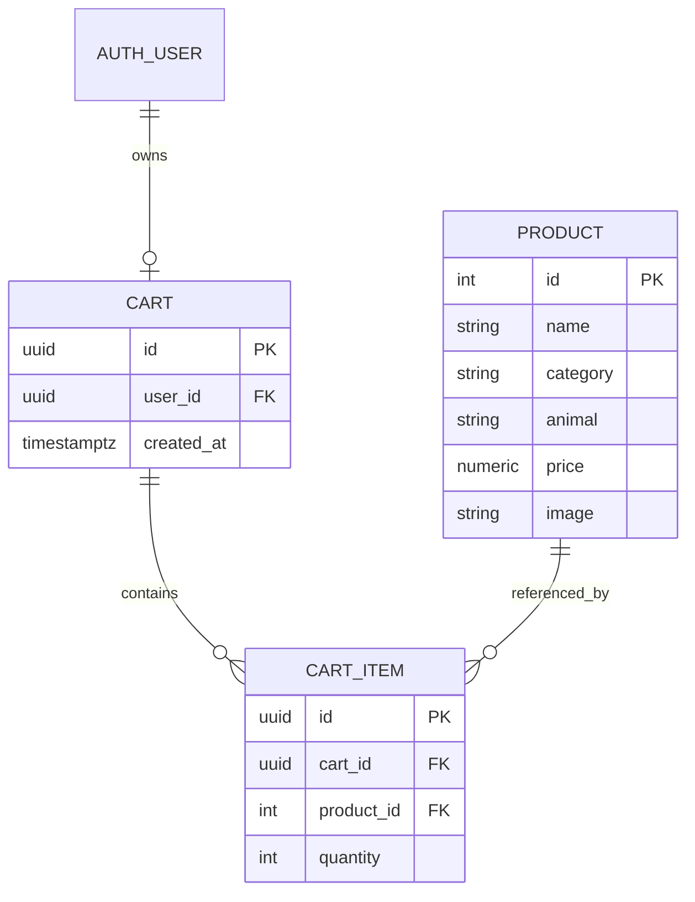

# Análisis de entidad, operaciones CRUD y seguridad de PetCocha

**Título:** Análisis técnico-académico de entidad, permisos y seguridad en la SPA PetCocha  
**Nombre del estudiante:** [Nombre del estudiante]  
**Asignatura:** [Asignatura]  
**Fecha:** [Fecha]

## 1. Descripción breve del sistema

PetCocha es una aplicación de una sola página construida con React para mostrar productos para mascotas y orientar su búsqueda.  
El catálogo y el carrito se conectan a Supabase Cloud; el carrito usa una sesión anónima y políticas RLS por usuario.
El usuario puede filtrar y comparar el catálogo, añadir artículos y enviar una solicitud de contacto o pedido.
La solicitud se guarda en `public.contact_messages`; el proyecto no procesa pagos ni confirma compras.

## 2. Entidad principal

### Entidades candidatas

| Candidata | Evidencia funcional | Evaluación |
|---|---|---|
| Producto | Catálogo leído de `public.products` en Supabase; la migración conserva los 39 IDs y la interfaz lo usa para filtrar, ordenar, comparar y añadir al carrito (`src/App.jsx`; `supabase/migrations/20261118193000_create_products_catalog.sql`). | **Seleccionada:** es el contenido central que articula las principales vistas e interacciones de compra. |
| Carrito y artículo de carrito | Carrito asociado al usuario anónimo autenticado; líneas remotas con `cart_id`, `product_id` y `quantity`, protegidas por RLS (`supabase/migrations/20261118195500_create_user_carts.sql`). | Importante para persistir la selección del usuario, pero deriva de los productos y no constituye el catálogo principal. |
| Solicitud de contacto o pedido | El formulario inserta los datos de contacto, texto y resumen opcional del carrito en `public.contact_messages`, protegida por RLS; distingue `Consulta`/`Pedido` y el estado inicial `Pendiente` (`src/components/ContentSections.jsx`; `src/App.jsx`; migraciones `20261118202000`, `20261122003600` y `20261122004400`). | Flujo secundario persistido; no es una orden confirmada ni procesa pagos. |
| Selección para comparación | Estado temporal con identificadores de producto y límite de tres elementos (`src/App.jsx`; `src/components/ComparisonBar.jsx`). | Interacción auxiliar del catálogo. |
| Respuesta de guía | Formulario local de mascota y etapa para filtrar alimentos (`src/components/ContentSections.jsx`; `src/App.jsx`). | Orientación de navegación, no registro persistente. |

### Justificación de la selección

La aplicación consulta el catálogo `public.products` y reutiliza sus IDs para presentar resultados, comparar detalles y construir líneas de carrito. La migración carga los 39 productos originales; `src/data/products.js` permanece como referencia para validar e importar carritos locales previos. La tabla remota es la fuente del precio vigente. Por su papel transversal y por ser el objeto principal de la tienda, **Producto** sigue siendo la entidad principal de este análisis.

### Atributos identificados

| Campo | Tipo de dato | Descripción | Obligatorio | Sensible |
|---|---|---|---|---|
| `id` | `integer` | Identificador usado en catálogo, comparador y como FK de `cart_items.product_id`. | Clave primaria; obligatorio. | No; es identificador de catálogo público. |
| `name` | `text` | Nombre o denominación comercial que se muestra al usuario. | Obligatorio (`NOT NULL`). | No; contenido público. |
| `category` | `text` | Categoría de navegación, por ejemplo alimentos, juguetes, accesorios o higiene. | Obligatorio (`NOT NULL`). | No; contenido público. |
| `animal` | `text` | Especie o conjunto de especies destinatarias que aparece en el catálogo y sirve para filtrar. | Obligatorio (`NOT NULL`). | No; contenido público. |
| `price` | `numeric(10,2)` en Supabase | Precio público mostrado en bolivianos; el carrito consulta el precio relacionado desde `products`. | Obligatorio, no negativo. | No es dato personal; sí es un dato comercial cuya integridad debe protegerse en una compra real. |
| `image` | `text` | Nombre de archivo de la imagen asociada al producto. | Obligatorio (`NOT NULL`). | No; referencia a un recurso público. |

Los tipos se infieren de los valores JavaScript; el proyecto no define una interfaz, esquema de validación ni restricciones de entidad. No se encontraron atributos de inventario, variantes, proveedor o identificador de administrador en esta estructura, por lo que no se incorporan.

## 3. Diagrama de la entidad

`cart_items` limita `quantity` a 1–99 y exige unicidad de `(cart_id, product_id)`. El precio no se duplica en la línea: se lee mediante la relación con `products`.

`public.contact_messages` genera `id` y `sent_at` en la base. También valida longitudes de nombre, correo y mensaje; formato de teléfono, motivo permitido, consentimiento y forma de la lista de artículos. `request_type` distingue `Consulta` de `Pedido`; `status` inicia como `Pendiente` y su asignación queda reservada a administración. El navegador no puede modificar el ID ni la fecha de envío. Los datos del carrito son informativos y no autorizan un precio ni una compra.

## 4. Matriz CRUD y permisos

**Roles:** el carrito crea un usuario anónimo con Supabase Auth; sus JWT usan el rol PostgreSQL `authenticated`, y RLS compara `auth.uid()` con el propietario del carrito. Los visitantes sin sesión usan `anon`. El acceso administrativo a solicitudes requiere el Dashboard o un servicio con rol administrativo, nunca una clave administrativa en el navegador.

| Entidad o dato | Crear | Leer | Actualizar | Eliminar |
|---|---|---|---|---|
| Producto del catálogo | **[Propuesto]** Administrador autenticado. No hay creación por interfaz. | **[Implementado]** Cualquier visitante puede consultar `public.products` mediante la política de lectura pública. | **[Propuesto]** Administrador autenticado. No hay edición por interfaz. | **[Propuesto]** Administrador autenticado, con control de integridad. No hay eliminación por interfaz. |
| Carrito | **[Implementado]** La app crea un carrito para la sesión anónima de Supabase Auth. | **[Implementado]** RLS permite a cada usuario autenticado leer solo su carrito. | **[Implementado]** Las líneas se actualizan por producto; la base valida cantidades de 1 a 99 y unicidad por carrito/producto. | **[Implementado]** Se pueden quitar líneas y vaciar el carrito; las políticas RLS restringen las acciones al propietario. |
| Solicitud y datos de contacto (nombre, teléfono, correo opcional, motivo, mensaje, tipo, estado, consentimiento y resumen opcional del carrito) | **[Implementado]** `anon` y `authenticated` pueden insertar con RLS; el estado inicial `Pendiente` se genera en la base. | **[Implementado]** Solo administración; los roles públicos no tienen permiso ni política de lectura. | **[Implementado]** Solo administración. | **[Implementado]** Solo administración. |

**Alcance efectivo de las operaciones.** En Productos, la lectura es pública; la administración CRUD no aparece como operación de usuario. En el carrito, autenticación anónima, carga, alta, cambio de cantidad, eliminación y vaciado se persisten en Supabase con RLS. El carrito local legado solo se importa cuando no hay uno remoto; las cantidades duplicadas se agrupan antes de validar y las filas remotas no duplican el precio. El formulario inserta solicitudes y no permite que visitantes las lean o editen. No hay interfaz administrativa ni se confirman pedidos o pagos.

Las validaciones HTML y comprobaciones de JavaScript del formulario mejoran la experiencia de entrada, pero no son autorización ni validación confiable frente a un servidor (`src/components/ContentSections.jsx:134-141`; `src/App.jsx:242-260`). La interfaz no ofrece una operación CRUD para administrar productos ni un mecanismo de control por rol.

## 5. Regla de seguridad indispensable

**Regla:** [Propuesto] El precio y el total de una compra deben determinarse y validarse en una fuente confiable del servidor; nunca se debe aceptar como importe definitivo el precio, cantidad o total enviado o calculado únicamente por el navegador.

1. **Por qué es indispensable.** Los archivos JavaScript y datos distribuidos por GitHub Pages son públicos y el usuario controla su navegador. Un cliente puede alterar los datos o el cálculo local; la cifra presentada por la SPA no demuestra por sí sola el importe autorizado ni la disponibilidad real.
2. **Código relacionado.** El precio vigente se consulta desde `public.products` y se relaciona con `cart_items` al cargar el carrito. La aplicación calcula el total en el cliente y guarda una copia informativa del resumen en el mensaje enviado; no se recalcula ni valida como importe de compra en un backend de checkout.
3. **Estado actual.** [Implementado] El carrito y las cantidades se guardan en Supabase con RLS por usuario; la base valida la cantidad y el precio se lee del producto remoto. Las solicitudes se insertan con RLS y restricciones de campos. [Pendiente] No existe un proceso que registre órdenes confirmadas o recalcule importes en un backend de checkout. [Riesgo potencial] No se debe tratar el resumen calculado en el cliente como importe autorizado para cobrar.
4. **Implementación correcta con backend.** [Propuesto] El backend debe obtener precio y disponibilidad desde su fuente autorizada, volver a calcular el total a partir de identificadores y cantidades, validar límites y estado del pedido, y exigir autorización del lado servidor para cualquier operación administrativa. El cliente debe recibir el importe recalculado y no poder fijarlo como verdad de negocio. Esta regla no puede implementarse de forma segura solo en React o en una página estática.

## 6. Duda técnica y respuesta

**Pregunta:** ¿Qué impide que un visitante cambie en las herramientas del navegador el total presentado como importe válido de un pedido?

**Respuesta y riesgo identificado.** La base impide que un usuario lea o modifique las líneas de otro carrito y valida las cantidades. El catálogo remoto es la fuente del precio al cargar las líneas, pero el total final se calcula en React y la solicitud no se transmite ni se valida en una API de checkout. Por tanto, el resumen no es una cifra autorizada para cobrar. Esto es un **riesgo potencial de integridad** si se incorpora un flujo transaccional, no evidencia de acceso a carritos ajenos ni de fraude confirmado.

**Recomendación técnica.** [Propuesto] Antes de aceptar pedidos o pagos, implementar una API con catálogo y precios autoritativos, recalcular el total en servidor y aplicar autenticación/autorización del lado servidor para los cambios administrativos. Mientras no exista backend, comunicar que el precio y la disponibilidad requieren confirmación humana —como ya advierte el catálogo— y no tratar el resumen del navegador como orden confirmada.

## 7. Conclusión

Producto es la entidad central y su catálogo es público en Supabase. [Implementado] El carrito se guarda por sesión anónima en `carts` y `cart_items`, con cantidades e integridad referencial protegidas por restricciones y RLS. Las solicitudes se guardan en `contact_messages` con tipo y estado pendiente; solo administración puede leerlas o gestionarlas. El comparador y la guía son estados temporales. Para confirmar pedidos o cobrar, además, se necesita un backend de checkout que valide disponibilidad y calcule el total autoritativamente.

## 8. Limitaciones del análisis

- [Implementado] Supabase Auth crea sesiones anónimas para el carrito. RLS restringe `carts` y `cart_items` al propietario autenticado; no se implementa una interfaz de administración de productos.
- [Implementado] El formulario solicita nombre, WhatsApp, correo opcional, motivo, mensaje y consentimiento (`src/components/ContentSections.jsx`). Tras confirmarlo, inserta en `public.contact_messages`; las restricciones de la migración validan los datos y RLS reserva lectura, actualización y eliminación para administración.
- [Pendiente] No se procesan pedidos ni pagos y no se mantiene inventario. El resumen de artículos y total llega desde el cliente y no debe usarse como importe de cobro.
- [Implementado] Un carrito local legado se importa una sola vez cuando el usuario todavía no tiene un carrito remoto. Después, las operaciones se guardan en Supabase; borrar los datos del navegador hace irrecuperable una sesión anónima sin identidad vinculada.
- [Verificado en Cloud] Se confirmó la lectura pública del catálogo, el guardado y aislamiento de carritos anónimos, el envío de solicitudes `anon` y `authenticated`, la denegación de lectura pública de mensajes y la consulta administrativa de pedidos con texto exacto y estado `Pendiente`. El precio temporal de un producto se restauró después de verificar la lectura actualizada en una línea existente.
- [Pendiente] No se completó el clic de envío del pedido desde el navegador local; las inserciones del flujo se probaron con el SDK contra Cloud y la ruta local respondió HTTP 200. Tampoco se procesan pagos ni se confirma disponibilidad.
