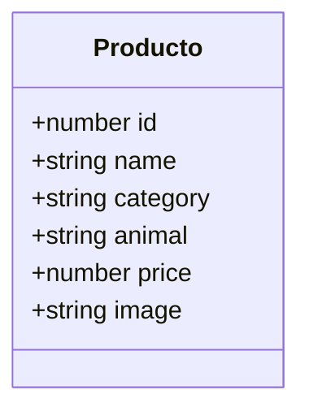

# Análisis de entidad, operaciones CRUD y seguridad de PetCocha

**Título:** Análisis técnico-académico de entidad, permisos y seguridad en la SPA PetCocha  
**Nombre del estudiante:** [Nombre del estudiante]  
**Asignatura:** [Asignatura]  
**Fecha:** [Fecha]

## 1. Descripción breve del sistema

PetCocha es una aplicación de una sola página construida con React para mostrar productos para mascotas y orientar su búsqueda.  
El usuario puede filtrar y comparar el catálogo, añadir artículos a un carrito y preparar una solicitud de contacto o pedido.  
El carrito se conserva en el almacenamiento local del navegador; la solicitud se presenta como un resumen para compartir.  
El proyecto no procesa pagos ni envía pedidos a un servidor, según la documentación del proyecto y la interfaz.

## 2. Entidad principal

### Entidades candidatas

| Candidata | Evidencia funcional | Evaluación |
|---|---|---|
| Producto | Catálogo de registros estáticos utilizado para filtrar, ordenar, comparar y añadir artículos al carrito (`src/data/products.js`; `src/App.jsx`). | **Seleccionada:** es el contenido central que articula las principales vistas e interacciones de compra. |
| Carrito y artículo de carrito | Estado local formado por identificador de producto y cantidad; se lee y guarda en `localStorage` (`src/App.jsx`). | Importante para la selección del usuario, pero deriva de los productos y no constituye el catálogo principal. |
| Solicitud de contacto o pedido | El formulario captura datos de contacto, motivo y mensaje; la aplicación crea un resumen en estado React **[Simulado]**, sin envío automático (`src/components/ContentSections.jsx`; `src/App.jsx`). | Flujo secundario y local, no una orden persistida. |
| Selección para comparación | Estado temporal con identificadores de producto y límite de tres elementos (`src/App.jsx`; `src/components/ComparisonBar.jsx`). | Interacción auxiliar del catálogo. |
| Respuesta de guía | Formulario local de mascota y etapa para filtrar alimentos (`src/components/ContentSections.jsx`; `src/App.jsx`). | Orientación de navegación, no registro persistente. |

### Justificación de la selección

La aplicación importa un catálogo de productos definido en código y lo reutiliza para presentar resultados, comparar detalles y construir las líneas del carrito. El archivo de datos contiene 39 registros con la misma estructura observable (`src/data/products.js:1-40`); la vista de catálogo recibe los productos filtrados (`src/App.jsx:304-320`). Por su papel transversal y por ser el objeto principal de la tienda, **Producto** es la entidad principal de este análisis.

### Atributos identificados

| Campo | Tipo de dato | Descripción | Obligatorio | Sensible |
|---|---|---|---|---|
| `id` | Número, inferido | Identificador utilizado para seleccionar, comparar y relacionar el producto con el carrito. | Está presente en todos los registros del catálogo; no hay una regla de validación declarada. | No; es identificador de catálogo público. |
| `name` | Cadena, inferido | Nombre o denominación comercial que se muestra al usuario. | Está presente en todos los registros; no se declara una validación de esquema. | No; contenido público. |
| `category` | Cadena, inferido | Categoría de navegación, por ejemplo alimentos, juguetes, accesorios o higiene. | Está presente en todos los registros; sus valores son datos codificados, no un tipo formal. | No; contenido público. |
| `animal` | Cadena, inferido | Especie o conjunto de especies destinatarias que aparece en el catálogo y sirve para filtrar. | Está presente en todos los registros; no se declara una restricción formal. | No; contenido público. |
| `price` | Número, inferido | Precio mostrado en bolivianos y empleado para ordenar y calcular el total local del carrito. | Está presente en todos los registros; no hay una validación de precio en servidor. | No es dato personal; sí es un dato comercial cuya integridad debe protegerse en una compra real. |
| `image` | Cadena, inferido | Nombre de archivo de la imagen asociada al producto. | Está presente en todos los registros; no hay validación de esquema declarada. | No; referencia a un recurso público. |

Los tipos se infieren de los valores JavaScript; el proyecto no define una interfaz, esquema de validación ni restricciones de entidad. No se encontraron atributos de inventario, variantes, proveedor o identificador de administrador en esta estructura, por lo que no se incorporan.

## 3. Diagrama de la entidad

Los tipos del diagrama son inferidos a partir del catálogo JavaScript; no corresponden a un modelo de base de datos implementado.

## 4. Matriz CRUD y permisos

**Roles:** no se implementan autenticación, identidad de usuario ni roles de autorización en el código inspeccionado. Por ello, los roles `visitante`, `cliente` y `administrador` que aparecen como roles futuros son **[Propuesto]**, no roles actuales. En una SPA estática, mostrar u ocultar una opción no establecería por sí mismo una autorización segura.

| Entidad o dato | Crear | Leer | Actualizar | Eliminar |
|---|---|---|---|---|
| Producto del catálogo | **[Propuesto]** Administrador autenticado. No hay creación por interfaz. | **[Implementado]** Cualquier visitante puede consultar el catálogo público. | **[Propuesto]** Administrador autenticado. No hay edición por interfaz. | **[Propuesto]** Administrador autenticado, con control de integridad. No hay eliminación por interfaz. |
| Carrito (producto y cantidad) | **[Implementado]** Visitante del navegador añade productos; no se exige identidad. | **[Implementado]** El mismo navegador muestra su carrito local. No existe una cuenta que limite la lectura al propietario. | **[Implementado]** El visitante puede aumentar o reducir cantidades localmente. | **[Implementado]** El visitante puede quitar artículos o vaciar el carrito al preparar un pedido. |
| Solicitud y datos de contacto (nombre, teléfono, correo opcional, motivo, mensaje y consentimiento) | **[Implementado]** El visitante puede completar el formulario; la solicitud solo se crea en estado del cliente para mostrar un resumen. | **[Implementado]** Se muestra en el navegador en el resumen de confirmación; no hay registro remoto ni control de identidad. | **[Implementado]** El visitante puede editar los campos antes de volver a preparar la solicitud; no hay actualización de un registro persistido. | **[Implementado]** Al cerrar el diálogo se limpia el objeto de solicitud de estado. No hay función de borrado de una solicitud almacenada en servidor, pues tal almacenamiento no existe. |

**Alcance efectivo de las operaciones.** En Productos, la lectura sí está implementada; la creación, modificación y eliminación de registros no aparecen como operaciones de usuario: los datos son estáticos en `src/data/products.js`. En el carrito, altas, cambios de cantidad y eliminación modifican el estado local y se persisten en `localStorage` (`src/App.jsx:48-54`, `src/App.jsx:105-109`, `src/App.jsx:201-219`, `src/App.jsx:349-352`). La solicitud se genera y presenta en el navegador; el propio código indica que no hay envío automático (`src/App.jsx:242-260`; `src/components/Dialogs.jsx:40-51`). Por tanto, esas operaciones del formulario no deben interpretarse como gestión de pedidos real.

Las validaciones HTML y comprobaciones de JavaScript del formulario mejoran la experiencia de entrada, pero no son autorización ni validación confiable frente a un servidor (`src/components/ContentSections.jsx:134-141`; `src/App.jsx:242-260`). La interfaz no ofrece una operación CRUD para administrar productos ni un mecanismo de control por rol.

## 5. Regla de seguridad indispensable

**Regla:** [Propuesto] El precio y el total de una compra deben determinarse y validarse en una fuente confiable del servidor; nunca se debe aceptar como importe definitivo el precio, cantidad o total enviado o calculado únicamente por el navegador.

1. **Por qué es indispensable.** Los archivos JavaScript y datos distribuidos por GitHub Pages son públicos y el usuario controla su navegador. Un cliente puede alterar los datos o el cálculo local; la cifra presentada por la SPA no demuestra por sí sola el importe autorizado ni la disponibilidad real.
2. **Código relacionado.** El precio está incluido en los objetos exportados del catálogo (`src/data/products.js:1-40`). La aplicación forma el total multiplicando precios por cantidades en el cliente (`src/App.jsx:83-88`) y copia ese total a la solicitud local (`src/App.jsx:253-260`). El diálogo solo presenta el resumen al usuario (`src/components/Dialogs.jsx:40-51`).
3. **Estado actual.** [Implementado] La SPA calcula y muestra importes localmente. [No verificable] No se puede verificar autenticación, autorización de administración, disponibilidad ni validación de importes en servidor porque el proyecto no tiene backend ni conexión con una base de datos. [Riesgo potencial] Si el resumen se utilizara posteriormente para aceptar o cobrar pedidos sin comprobación independiente, el cliente podría manipular los valores. No se confirma una transacción vulnerable en la funcionalidad actual, porque el proyecto no envía ni procesa el pedido.
4. **Implementación correcta con backend.** [Propuesto] El backend debe obtener precio y disponibilidad desde su fuente autorizada, volver a calcular el total a partir de identificadores y cantidades, validar límites y estado del pedido, y exigir autorización del lado servidor para cualquier operación administrativa. El cliente debe recibir el importe recalculado y no poder fijarlo como verdad de negocio. Esta regla no puede implementarse de forma segura solo en React o en una página estática.

## 6. Duda técnica y respuesta

**Pregunta:** ¿Qué impide que un visitante cambie en las herramientas del navegador el precio de un producto o la cantidad guardada localmente y presente un total alterado como importe válido de un pedido?

**Respuesta y riesgo identificado.** En el código disponible no hay un control que establezca una cifra autoritativa remota: el catálogo y el cálculo del total residen en el cliente, y el carrito se guarda en `localStorage` (`src/data/products.js:1-40`; `src/App.jsx:48-54`, `src/App.jsx:83-88`, `src/App.jsx:105-109`). El visitante puede modificar los datos que controla en su propio navegador; por tanto, el resumen no prueba un precio ni una cantidad aceptados por PetCocha. Esto es un **riesgo potencial de integridad**, no evidencia de acceso a datos de otros clientes ni de fraude confirmado: el flujo actual solo prepara una solicitud visible localmente y no la envía automáticamente (`src/components/ContentSections.jsx:121-124`; `src/components/Dialogs.jsx:40-51`).

**Recomendación técnica.** [Propuesto] Antes de aceptar pedidos o pagos, implementar una API con catálogo y precios autoritativos, recalcular el total en servidor y aplicar autenticación/autorización del lado servidor para los cambios administrativos. Mientras no exista backend, comunicar que el precio y la disponibilidad requieren confirmación humana —como ya advierte el catálogo— y no tratar el resumen del navegador como orden confirmada.

## 7. Conclusión

Producto es la entidad central y su catálogo es público y estático. Las capacidades actuales de carrito y contacto son experiencias locales, no operaciones autenticadas sobre datos persistentes compartidos. [Implementado] Solo el carrito se guarda en `localStorage`; el formulario de contacto no persiste allí los datos capturados y muestra la solicitud temporalmente en el navegador. [No verificable] No existen controles de servidor que permitan confirmar identidad, permisos, precios vigentes o disponibilidad. Para convertir esta SPA en una tienda transaccional, la prioridad es añadir un backend que autorice las operaciones y valide los datos de negocio de manera independiente del cliente, además de definir una política de tratamiento y retención de datos personales.

## 8. Limitaciones del análisis

- [No verificable] No se pueden confirmar autenticación, roles, permisos, almacenamiento centralizado, recepción de solicitudes, procesamiento de pedidos, inventario ni pagos; no hay backend o base de datos identificados en la aplicación inspeccionada.
- [Implementado] El formulario solicita nombre, WhatsApp, correo opcional, motivo, mensaje y consentimiento (`src/components/ContentSections.jsx:124-143`). La solicitud se mantiene en estado de React y se representa en un diálogo; no se observó su envío a un tercero o servidor (`src/App.jsx:242-278`; `src/components/Dialogs.jsx:40-51`).
- [Implementado] El carrito se almacena en `localStorage`, espacio accesible desde el navegador del visitante para el origen del sitio (`src/App.jsx:48-54`, `src/App.jsx:105-109`). El análisis no afirma que esa implementación exponga datos de carrito a otros usuarios.
- [No verificable] No se inspeccionó el comportamiento en producción ni se ejecutaron pruebas dinámicas. El análisis se limita a los archivos fuente y documentación disponibles en el workspace; las reglas propuestas para una futura tienda con backend no describen funciones existentes.
